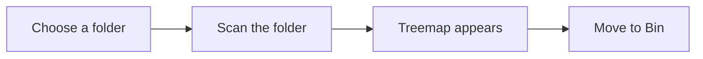

## Find what is filling your drive

Erase & Rewrite shows you how the space on a drive is actually used. It draws the contents of a folder as a treemap, a picture made of rectangles where each rectangle stands for a folder or a file. When you spot something you do not need, you remove it by moving it to the Bin.

Nothing is hidden and nothing is guessed. The picture is built from real sizes, so you can decide what to keep, what to move elsewhere, and what to delete.

## How it works

You choose a folder. The program scans that folder and everything inside it, all the way down, and then draws the treemap. The area of each tile is the share of the drive's total capacity that the folder or file takes. A tile that fills a quarter of the picture holds a quarter of the drive's space.

Scanning only reads. It never renames, moves, or deletes anything on the drive. The one action that changes the drive is **Move to Bin**, and it only touches the item you picked.

## Terms you will meet

- **Treemap**: the picture of a folder and everything inside it, drawn to scale.
- **Tile**: one rectangle in the treemap, standing for a folder, a file, or a group of very small items.
- **Target folder**: the folder you chose to open. The scan starts there and covers everything inside it.
- **Context folder**: the folder currently shown in the treemap. You can step down into its subfolders and back up again.
- **Clump**: a group of items too small to draw on their own, shown together as a single tile.
- **Packed**: a file or folder that is really an archive, such as a `.zip` or `.rar` file. The treemap shows it as one item.

## The main window

Everything happens in one window, and it is the same every time you start the program.

- **Main menu**: File, Inspect, Tools, and Help. The commands you need live here.
- **Toolbar**: buttons for the actions you use most, such as Open, Save, Up, Explore, Bin, Update, and Stop.
- **Treemap**: fills the middle of the window. This is where the folder you opened appears.
- **Status bar**: sits at the bottom and shows a hint, or the path to the folder you are looking at.

The toolbar also carries two readouts about the drive itself. `Total at X:` is the capacity of the drive. `Free at X:` is the free space on it right now. If the free-space figure looks out of date, click it to refresh it.

## When you start the program

The program opens with your settings already loaded. The treemap area is empty and the status bar reads **Choose a target folder**. That is the program telling you it is waiting for you.

<Steps>
<Step title="Open the File menu">

Choose **File** → **Open a Folder**, or press <kbd>Ctrl</kbd>+<kbd>O</kbd>.

</Step>
<Step title="Pick a folder">

Choose the folder you want to look inside. Start with something large, such as your Downloads folder or a drive letter, to see where space goes quickly.

</Step>
<Step title="Wait for the scan to finish">

The program reads the folder and everything inside it. The treemap stays empty while it works, then appears complete when the scan is done, and the status bar shows the path to the folder you are looking at.

</Step>
</Steps>

The full walkthrough, including how to stop a long scan, is in [Opening a folder and scanning](/user-manual/opening-a-folder).

<Callout kind="info">

The treemap does not update on its own. If files change on the drive after the scan, the picture you see is out of date. Choose **Inspect** → **Update** to scan the context folder again. See [Saving and updating](/user-manual/saving-and-updating).

</Callout>

## In this manual

<Columns cols={2}>
<Card title="Opening a folder and scanning" href="/user-manual/opening-a-folder" icon="folder">

Choose a folder, watch the scan run, and stop it if it takes too long.

</Card>
<Card title="Reading the treemap" href="/user-manual/reading-the-treemap" icon="bar-chart">

Understand tile sizes, clumps, and the colours on the map.

</Card>
<Card title="Moving around" href="/user-manual/moving-around" icon="arrow-right">

Step into subfolders, go back up, and explore in Explorer.

</Card>
<Card title="Removing items safely" href="/user-manual/removing-items" icon="trash">

Move items to the Bin and know exactly what happens next.

</Card>
<Card title="Saving and updating" href="/user-manual/saving-and-updating" icon="download">

Save the folder you are viewing as a plain text file and refresh the map after files change.

</Card>
<Card title="Settings" href="/user-manual/settings" icon="settings">

Adjust how the treemap looks and how scanning behaves.

</Card>
<Card title="Keyboard shortcuts" href="/user-manual/keyboard-shortcuts" icon="terminal">

Work faster with the keys for open, update, and navigation.

</Card>
<Card title="Troubleshooting" href="/user-manual/troubleshooting" icon="help-circle">

Fix a scan that will not start or a map that looks wrong.

</Card>
</Columns>

For the complete rules behind every command and readout, the full behaviour is defined in the [functional specification](/specs/funcspec).